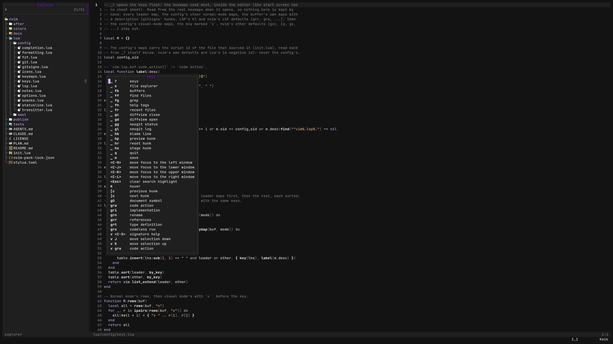
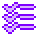

smol's hand-built Neovim 0.12 config: native `vim.pack`, no distro, a plugin added only
when something hurt without it, and headless tests for what it does.

<!-- smol:readme hud -->
<a href=".github/readme/hud.svg#gh-dark-mode-only">
<picture>
  <source media="(max-width: 600px)" srcset=".github/readme/hud-narrow.svg">
  
</picture>
</a>
<a href=".github/readme/hud-light.svg#gh-light-mode-only">
<picture>
  <source media="(max-width: 600px)" srcset=".github/readme/hud-narrow-light.svg">
  
</picture>
</a>
<!-- /smol:readme -->

##  Start here

It needs Neovim 0.12 or newer, and `git`, `rg`, `fd`, `fzf`, a C compiler and
`tree-sitter` 0.26.1 or newer. The rest is optional: `cargo` builds blink.cmp's Rust
fuzzy matcher (without it completion uses the Lua one), and each language server and
formatter is used when it is there. `:checkhealth smol` lists all of it with the Arch
package to install.

On Arch:

```sh
sudo pacman -S neovim git ripgrep fd fzf gcc tree-sitter-cli
# optional
sudo pacman -S rustup rust-analyzer lua-language-server biome stylua shfmt yamlfmt taplo-cli
rustup default stable
yay -S vtsls vscode-langservers-extracted prettierd
sudo npm install -g @astrojs/language-server
```

Try it without touching your own config: it lives in `~/.config/smol_nvim` and keeps its
plugins and state under that name.

```sh
git clone https://github.com/Smol-indie-dev/smol_nvim ~/.config/smol_nvim
NVIM_APPNAME=smol_nvim nvim
```

To make it your config, move yours aside (`~/.config/nvim`, and `~/.local/share/nvim`,
`~/.local/state/nvim`, `~/.cache/nvim` so no old plugins linger), then:

```sh
git clone https://github.com/Smol-indie-dev/smol_nvim ~/.config/nvim
nvim
```

The first start asks `Proceed? [Y]es` before `vim.pack` installs the plugins at the
versions in `nvim-pack-lock.json`: press `y`. With `cargo`, blink.cmp's matcher is built
next; then nvim-treesitter compiles the parsers in the background. Wait until it is
done, quit and start again: the second start is quiet. `:checkhealth smol` shows what is
still missing.

##  How it works



`init.lua` checks the version, loads the plugins with `vim.pack.add` and requires one
file per concern from `lua/config/`. The plugins:

- **nvim-lspconfig**: the servers' defaults, enabled with `vim.lsp.config`.
- **blink.cmp** and **blink.lib**: completion.
- **nvim-treesitter** (`main`): the parsers, started with `vim.treesitter.start()`.
- **fzf-lua**: files, text, buffers, help and recent files.
- **gitsigns.nvim**: the hunks in the sign column.
- **conform.nvim**: format on save.
- **neogit**, **diffview.nvim** and **plenary.nvim**: git status, log and diffs.
- **mini.icons**: file icons.
- **snacks.nvim**: the start screen and the explorer.

**The smol look.** The colour scheme is its own, `colors/smol.lua`, drawn from the smol
desktop's palette. The background is transparent: the terminal's own colour shows
through. Code is white with lavender keywords and types, grey punctuation and comments,
and yellow literals; the frame (selection, floats, statusline, cursor line) is the
palette's, and every float has a square border. Colours keep one meaning each: red is a
failure or a removal, yellow a warning, a change or code, green ok or an addition, cyan
a heading. Glyphs come from one table, `lua/smol/glyphs.lua`. The statusline is written
by hand: mode, the path in the buffer's project, the branch, the error and warning
counts.

**Projects.** A buffer's project is its git root (a worktree's too). The pickers, the
explorer and Neogit open there, not in Neovim's working directory, so one Neovim can
move between repos.

**Format on save only where the repo asks for it.** prettierd, biome, stylua, taplo,
yamlfmt and shfmt run only when their config file sits between the file and its git
root; rustfmt always runs. A repo without a formatter's config is never reformatted
behind its back.

**Tested.** `tests/run` runs each `tests/*.lua` in a headless Neovim with every XDG
directory in a temp dir, so nothing real is written; a test fails by throwing. The
plugins come from the site the first start installed (under `NVIM_APPNAME` too). Two
tests compare values with smol's own tools and skip where those are not checked out.

```sh
stylua --check .
tests/run
```

### Keys

The leader is space, drawn `␣`. `␣?` opens this list inside the editor, read from the
real keymaps; `tests/readme.lua` fails when the table below differs from it. A key
marked `v` is visual mode's. In a git repo with a language server attached, `␣?` also
lists the hunk keys and `K`.

<!-- nvim:keys -->
| Key | What |
|---|---|
| `␣ ?` | keys |
| `␣ e` | file explorer |
| `␣ fb` | buffers |
| `␣ ff` | find files |
| `␣ fg` | grep |
| `␣ fh` | help tags |
| `␣ fr` | recent files |
| `␣ gc` | diffview close |
| `␣ gd` | diffview open |
| `␣ gg` | neogit status |
| `␣ gl` | neogit log |
| `␣ q` | quit |
| `␣ w` | save |
| `<C-H>` | move focus to the left window |
| `<C-J>` | move focus to the lower window |
| `<C-K>` | move focus to the upper window |
| `<C-L>` | move focus to the right window |
| `<Esc>` | clear search highlight |
| `gO` | document symbol |
| `gra` | code action |
| `gri` | implementation |
| `grn` | rename |
| `grr` | references |
| `grt` | type definition |
| `grx` | codelens run |
| `v <C-S>` | signature help |
| `v J` | move selection down |
| `v K` | move selection up |
| `v gra` | code action |
<!-- /nvim:keys -->

##  Layout

| Path | What |
|---|---|
| `init.lua` | the version check, the leader, blink's build hook, `vim.pack.add`, then the rest |
| `nvim-pack-lock.json` | the plugins' pinned versions, written by `vim.pack` |
| `colors/smol.lua` | the colour scheme: the smol palette and its colour meanings |
| `lua/config/options.lua`, `keymaps.lua` | options and the global keys |
| `lua/config/lsp.lua`, `completion.lua` | the language servers and the diagnostic signs; blink.cmp |
| `lua/config/treesitter.lua` | the parsers |
| `lua/config/fzf.lua` | the pickers and their keys |
| `lua/config/formatting.lua` | conform and the format-on-save rule |
| `lua/config/notes.lua` | Markdown notes of smol's note tool: never formatted, named in the statusline |
| `lua/config/gitsigns.lua`, `git.lua` | hunk signs; Neogit and Diffview |
| `after/plugin/neogit.lua` | `:Neogit` in the buffer's project |
| `lua/config/statusline.lua` | the statusline |
| `lua/config/snacks.lua`, `icons.lua` | the start screen and the explorer; mini.icons |
| `lua/config/keys.lua` | `␣?`, the keys float |
| `lua/smol/` | the palette and its blends, the glyphs, the buffer's project, `:checkhealth smol` |
| `tests/` | `tests/run` and the headless tests |

##  How it was built

- **Planned in writing.** Each piece was a phase of a written plan with its acceptance
  test decided before the code, one working session each.
- **Reviewed by a second model.** One of Claude and Codex drafted a plan, the other
  reviewed it; smol made the calls.
- **Tests before code.** A phase's test was written first and seen to fail; deliberate
  breaks of the code were each seen to fail it too.
- **Checked before every commit.** `stylua --check .` and `tests/run`; what can only be
  seen was looked at in the terminal.
- **Published from a private working repo.** The plans, reviews and session notes stay
  there; this repo gets the config, its tests and this README, one commit per publish.


<p align="center">
  <a href="https://site.smolindiedev.workers.dev/type-escape/"
     title="I'm once again asking you to let me quit the text editor.">
    </a><br>
  MIT · SMOL CODE, BIG FUN
</p>
